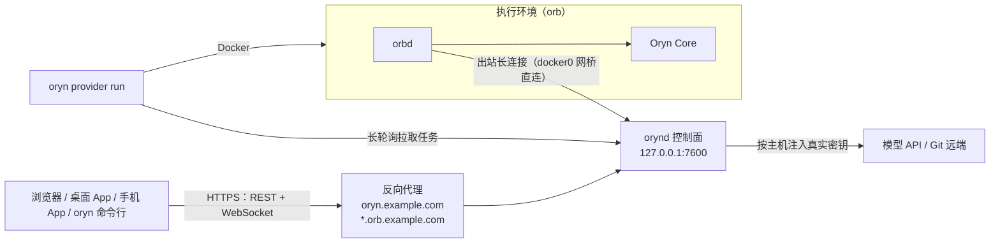

_本页回答：一套 Oryn 由什么组成，哪些必须装、哪些按需装，先装什么后装什么？_

Oryn 按单节点部署：控制面 `orynd` 只监听本机，放在你现有的反向代理之后；同一台机器上的 `oryn provider run` 用 Docker 运行执行环境（orb）。其余组件都是可选的，只在你要用对应功能时才装。完成初始化的你是这套 Oryn 的所有者。

## 单节点拓扑

几点值得注意：

- 客户端都经反向代理访问控制面；环境不经反代，直接连控制面监听的 docker0 网桥地址。
- Provider 以长轮询向控制面拉取任务。
- 默认 `proxy` 模式下，模型与 Git 的真实密钥只在控制面，由它按上游主机注入，环境里只有 `oryn-ph-…` 占位符。细节见[凭据隔离与出站代理](/security/credentials/)。

## 组件

| 组件 | 职责 | 运行位置 |
|---|---|---|
| `orynd` | 控制面单二进制：REST + WebSocket、SQLite、Passkey 与设备配对、调度、协调沙箱、出站密钥注入代理、内嵌 Web 前端 | 控制面主机，以 `oryn` 系统用户运行 |
| `oryn` | 命令行客户端与宿主机 Provider 执行器（`docker`、`firecracker`、脚本 `dispatch`） | 你的电脑；作为 Provider 时在宿主机上 |
| `orbd` | 环境内守护进程：出站长连接回控制面，监督 Oryn Core，托管服务、桌面与本地出站代理；`--runner` 模式接入个人机器 | 环境镜像里；Runner 模式在你自己的机器上 |
| 环境镜像 `oryn-orb:dev` | Arch Linux 开发镜像，不随版本发布，要在同一版本的源码里用 `make image` 构建 | Docker 宿主机 |
| 反向代理 | 为主域名与 Portal 泛域名提供 HTTPS | 控制面主机 |

服务端发布包 `oryn-server_<版本>_linux-{x64,arm64}.tar.gz` 里还有 `gemini-rerank` 与 `oryn-push-gateway`，分别是 Hindsight 的重排适配器与自建推送网关。

## 系统前提

| 项 | 要求 |
|---|---|
| 操作系统与架构 | Linux，x86_64 或 ARM64（服务端发布包只有这两种） |
| 容器 | Docker，供 Docker Provider 运行环境 |
| git | 控制面主机上 2.31 或更高版本；没有时仓库浏览停用，其余功能照常 |
| 磁盘 | 环境镜像解压后约 10.2 GB；控制面数据盘与 `oryn.db` 同盘，写满会让整个控制面停摆 |
| 域名与证书 | 主域名（如 `oryn.example.com`）与证书，必须走 HTTPS：Passkey 的 RP ID 取 `public_url` 的主机名，桌面 App 要求服务器走 HTTPS |

## 必需与可选

前三项构成能开线程的最小部署，其余按功能取用。

| 功能 | 需要的组件 | 页面 |
|---|---|---|
| 在浏览器、App、命令行里使用 Oryn | 控制面、反向代理与 HTTPS | [配置控制面](/admin/install/control-plane/)、[反向代理与 HTTPS](/admin/install/reverse-proxy/)、[启动与初始化](/admin/install/first-start/) |
| 线程在隔离环境里运行 | Docker Provider 与环境镜像 | [安装二进制与镜像](/admin/install/binaries-and-image/)、[接入 Docker Provider](/admin/install/docker-provider/) |
| Agent 调用模型 | 上传 omp 配置，明文 API Key 移入控制面的加密密钥库 | [模型与密钥](/guide/agent/models-and-keys/) |
| 环境与宿主、内网、元数据地址隔开 | 专用网桥与防火墙规则（建议） | [网络隔离与加固](/admin/install/network-isolation/) |
| 在浏览器里打开受管服务、Boxes 应用地址、Artifact 隔离帧与发布页 | Portal 泛域名：通配 DNS 与通配证书 | [启用 Portal 泛域名](/admin/install/portal/) |
| 全局助手、Space | 协调宿主：控制面主机上的 omp，内核 Landlock ABI ≥ 2（内核 ≥ 5.19） | [协调宿主](/admin/components/coordinator/) |
| 助手联网、MCP、后台研究、助手的电脑 | 协调宿主之上的联网设置 | [助手联网、MCP 与后台研究](/admin/components/assistant-network/) |
| 连接 GitHub、PR 与事件回流 | 你自己注册的 GitHub OAuth App | [GitHub 集成：注册 OAuth App](/admin/components/github-oauth/) |
| Agent 记忆、主人记忆 | 单独部署的 Hindsight 服务 | [Hindsight 记忆服务](/admin/components/hindsight/) |
| Word / Excel / PowerPoint 在线编辑、旧版格式导入、高保真 PDF 导出 | Collabora Online（CODE），单独一个域名 | [Office 引擎（Collabora）](/admin/components/office-engine/) |
| iOS 与 Android `gms` 包的推送 | 缺省使用官方推送网关，无需部署；自编 App 才要自建网关 | [移动推送与自建推送网关](/admin/components/push-gateway/) |
| 托管仓库与仓库浏览 | 控制面上的 git；反代放开 `/git/` 的请求体上限 | [仓库镜像与托管仓库入口](/admin/components/repos/) |
| 新环境从快照启动、直接认领已完成 setup 的环境 | 项目快照（默认开启）与预热池（在项目设置里设成 1–3 台） | [快照与预热池](/admin/backends/snapshots-pool/) |
| 环境里运行 Docker | Sysbox，且先完成网络隔离并开启 link 的 TLS | [带 Docker 的环境（Sysbox）](/admin/backends/sysbox/) |
| 每个环境一台 microVM | Firecracker Provider：x86_64 宿主，`/dev/kvm` 可用，Provider 以 root 运行 | [Firecracker Provider](/admin/backends/firecracker/) |
| Agent 开零凭据、用完即焚的沙箱 | 控制面的 `sandbox` 设置与 Provider 侧的沙箱网络 | [启用 Agent 沙箱](/admin/backends/sandbox/) |
| 用其它基础设施创建环境 | `dispatch` 驱动与你的脚本 | [用脚本接入其它后端（dispatch）](/admin/backends/dispatch/) |
| 线程在你自己的机器上运行 | 那台机器上以普通用户运行 `orbd run --runner` | [在自己的机器上跑线程（Runner）](/guide/environments/runner/) |

## 最小安装的顺序

各步依赖前一步的结果：控制面配置要用到服务用户与目录，初始化要求反代与 HTTPS 已就绪，创建 Provider 要先有所有者批准设备配对，上传模型配置要先登录。

| 顺序 | 页面 | 完成后 |
|---|---|---|
| 1 | [安装二进制与镜像](/admin/install/binaries-and-image/) | `orynd`、`oryn` 已安装，`oryn-orb:dev` 已构建，`oryn` 服务用户与 `/var/lib/oryn` 已创建 |
| 2 | [配置控制面](/admin/install/control-plane/) | `/etc/oryn/orynd.yaml` 写好 |
| 3 | [反向代理与 HTTPS](/admin/install/reverse-proxy/) | 主域名经 HTTPS 转发到 `127.0.0.1:7600` |
| 4 | [启动与初始化](/admin/install/first-start/) | `orynd` 以 systemd 运行，你已注册 Passkey 并保存恢复码 |
| 5 | [接入 Docker Provider](/admin/install/docker-provider/) | `oryn-provider` 以 systemd 运行，线程可以启动环境 |
| 6 | [模型与密钥](/guide/agent/models-and-keys/) | 模型配置已上传，`data_dir/master.key` 已备份 |

之后建议做[网络隔离与加固](/admin/install/network-isolation/)，需要 Portal 时[启用 Portal 泛域名](/admin/install/portal/)，再按上表启用可选组件。备份要点见[备份](/admin/operations/backup/)。
