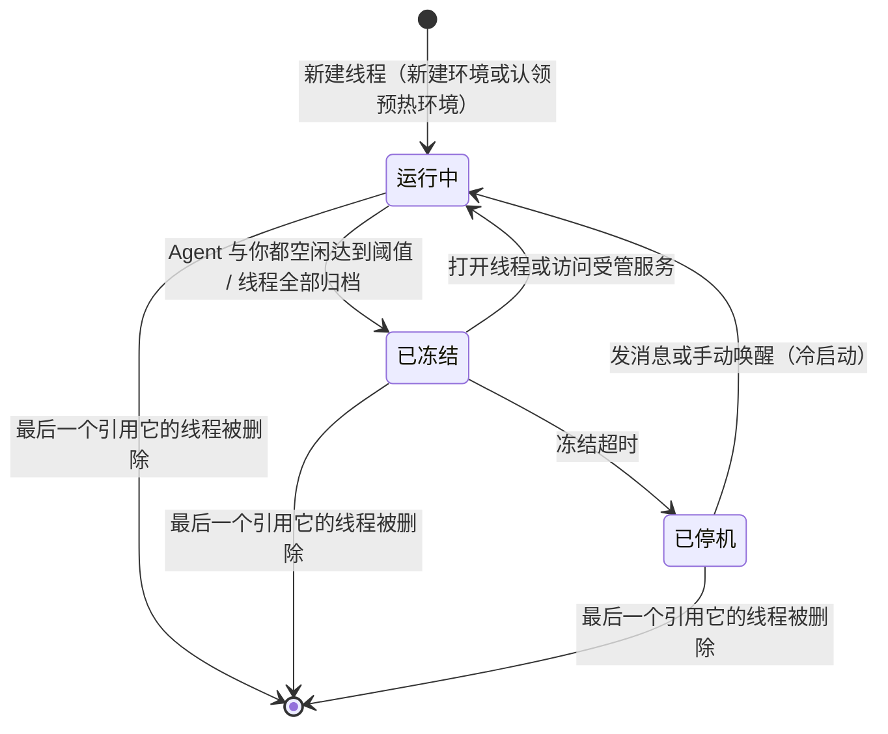

*本页回答：执行环境什么时候创建、冻结、停机、删除？*

执行环境（orb）是线程的运行环境，不是要你挑选或清理的资源。它跟着线程走：新线程总有一台新环境，空闲时自动冻结，线程全部归档后冻结，最后一个引用它的线程删除时一并删除。界面上不列出已有环境，也不显示环境编号；信息面板里悬停可以看到编号，供排查。

## 状态与转换

## 创建

新建线程总是得到一台新环境，或者认领项目预热池里一台已完成 setup 的环境。项目有快照时，新环境从快照启动，跳过构建，直接运行 `.oryn/resume`。快照与预热池见[环境配置](/guide/projects/environment/)。

命令行 `oryn thread new --orb` 与 API 的 `executor.kind = "orb"` 仍可以把新线程挂到已有环境上，留给脚本与高级用法。

## 冻结与唤醒

Agent 与你都空闲达到阈值后，环境自动冻结：Docker 环境暂停容器，Firecracker 环境停 vCPU。打开线程或访问受管服务时自动唤醒，唤醒后运行 `.oryn/resume`。

Firecracker 环境冻结时只停 vCPU，内存仍留在宿主进程里，和 `docker pause` 一样占内存。

## 停机

冻结超时后，环境转为停机，磁盘状态完整保留。Firecracker 环境停机时，Provider 向 guest 发关机请求，30 秒内不退出就强杀；磁盘和槽位保留，下次唤醒重新开机。

停机的环境唤醒要冷启动，所以打开线程时不会自动唤醒它，只有发消息或手动唤醒才会。停机期间文件面板仍可浏览和预览环境里的文件，且不会唤醒它：Docker Provider 从已停止的容器里读取，Firecracker Provider 在用户态解析 VM 磁盘，不挂载。需要编辑时一键唤醒，见[文件面板与预览](/guide/workbench/files/)。

## 空闲阈值

阈值由控制面配置的 `idle.*` 键决定，可在「设置 → 控制面」覆盖，无需重启：

| 键 | 缺省值 |
|---|---|
| `idle.agent_idle` | `5m` |
| `idle.user_idle` | `20m` |
| `idle.stop_after_frozen` | `24h` |
| `idle.wake_on_focus` | `true` |

键的完整说明见 [`orynd.yaml` 参考](/reference/config/orynd-yaml/)。

## 归档线程时

线程全部归档后，环境在下一轮空闲评估（不超过 30 秒）就冻结。归档线程的环境只冻结或停机，不删除；取消归档后可以继续在原环境里工作。

## 删除线程时

最后一个引用环境的线程（包括已归档的）被删除时，环境一并删除。「无引用」的判定与进入删除在同一个事务里；把线程挂到环境上的写入事务会复核环境没有在删除，二者串行。

分叉时选「共用当前 orb」的线程与原线程引用同一台环境，环境在它们都被删除后才删除。分叉见[回退、分叉与会话树](/guide/threads/rewind-fork/)。

## 定时任务的旧运行

定时任务的 `keepLast` 让旧运行自动归档。被自动归档的旧运行只回收它独占的环境；别的线程还在用这台环境时（哪怕已归档，例如从它共用环境分叉出的线程），环境保留。这一判定同样在一个事务里完成。定时任务见[定时任务](/guide/automation/schedules/)。

## 相关

- [选择执行后端](/guide/environments/backends/)
- [环境配置：setup、resume、快照与预热](/guide/projects/environment/)
- [信息面板](/guide/workbench/info-panel/)
