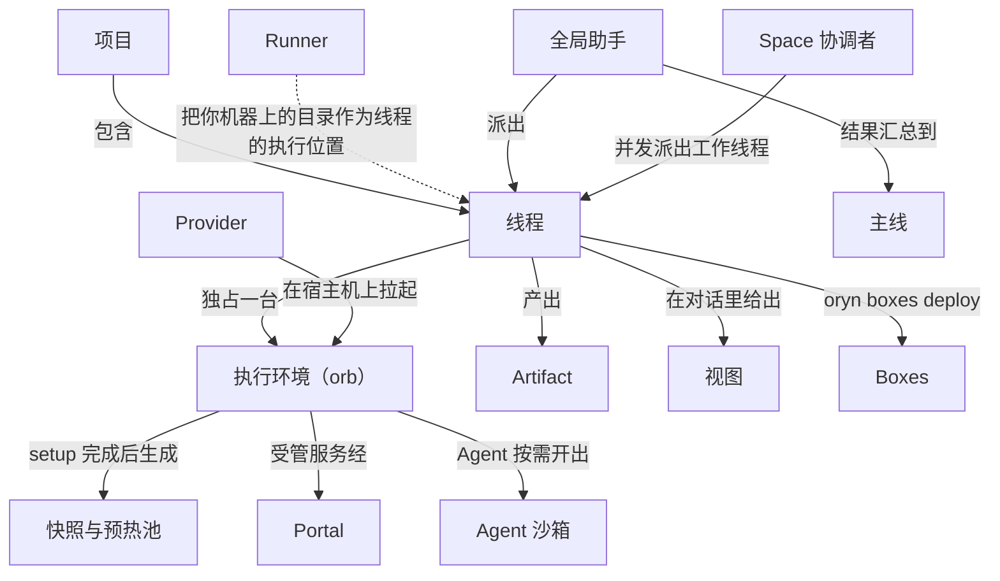

*本页回答：读后面的文档之前，要先认识哪些词？*

下图是这些概念之间的主要关系。每一节给出两三句定义，并链到详细的指南。

## 项目

项目把仓库、环境与脚本绑在一起，回答「这个代码库现在怎么样了」。仓库有三种来源：「已有仓库」「空白仓库（Oryn 托管）」与「不带仓库」。项目还承载自己的环境脚本、Agent 配置、定时任务、SSH 主机与密钥。详见[创建与管理项目](/guide/projects/manage/)。

## 线程

线程是你与 Agent 的一段对话。每个线程运行在自己的执行环境里，Agent 内核是 Oryn Core。线程可以归档、分叉，也可以公开分享。详见[新建线程与选择执行位置](/guide/threads/new-thread/)。

## 执行环境（orb）

环境是线程的执行环境，不是要你挑选或清理的资源：新建线程总是得到一台新环境（或认领预热池里的一台）。Agent 与你都空闲达到阈值后，环境自动冻结；打开线程或访问受管服务时自动唤醒；冻结超时后转为停机，磁盘状态完整保留。最后一个引用它的线程删除时，环境一并删除。详见[环境如何随线程生灭](/guide/environments/lifecycle/)。

## Provider

Provider 是宿主机上运行 `oryn provider run` 的执行器，向控制面长轮询拉取任务，用 Docker、Sysbox 或 Firecracker 拉起环境。同一个控制面可以同时接入多个 Provider，按项目或线程选用。详见[选择执行后端](/guide/environments/backends/)。

## Runner

Runner 是你自己机器上的普通用户进程，以 `orbd run --runner` 直连指定目录，让线程直接在本地目录与本地硬件上工作。Runner 只接收不含密钥的配置，模型、记忆与 SSH 主机都经控制面中转访问。目录已有活动线程时，可以新建独立的 `git worktree`。详见[在自己的机器上跑线程（Runner）](/guide/environments/runner/)。

## 快照与预热池

项目首次完成 `.oryn/setup` 后，Oryn 自动生成一份干净的磁盘快照，之后的新线程跳过构建，直接运行 `.oryn/resume`。高频项目可以配置 1–3 台常驻预热池，新建线程时直接认领。详见[环境配置：setup、resume、快照与预热](/guide/projects/environment/)。

## 全局助手

全局助手运行在控制面的协调沙箱里，按三层执行：自己动手（搜索、读网页、生图、调用 MCP）、遥控一台属于它的电脑、替你派出与管理 Agent。删除、公开分享与密钥类设置不会直接执行，要你在确认卡上点「是」。详见[认识全局助手](/guide/assistant/overview/)。

## 主线

主线是助手分区最上面置顶的一条永久对话，不能归档或删除。定时任务与 GitHub 规则的结果、助手派出的线程的回报、助手给自己设的提醒、后台研究的发现都汇到这里，助手判断值得说时才打扰你。详见[主线：结果汇总与提醒](/guide/assistant/mainline/)。

## Space

Space 由一个协调者在严格沙箱里拆解目标、并发派出工作线程，并在需要你决策时汇总提醒。协调者只有 `read` / `write` 两个内置工具，不能联网、没有 MCP，也不能读写或操控 Runner 线程。详见[Space：并行协调多条线程](/guide/automation/spaces/)。

## Artifact

Artifact 是 Agent 做出的页面、画布、文档（Markdown）与幻灯片，以及 Word / Excel / PowerPoint / PDF 原生文件。每次写入生成一个新版本，删除的进「最近删除」保留 30 天；每个 artifact 在隔离的沙箱帧里渲染。详见[Artifacts 概览](/guide/artifacts/overview/)。

## 视图

视图是 Agent 直接在对话里给出的可交互界面：表单、选项、KPI、表格、图表、示意图或小工具。它是转录里的一次性回答，随对话走，不进 Artifacts 列表；要留存、迭代或发布的成品仍做成 artifact。详见[视图：对话里的交互界面](/guide/artifacts/views/)。

## Portal

Portal 经泛域名把环境里的开发服务器暴露给浏览器，地址形如 `https://t-<短码>-p<端口>.<portal_domain>/`。默认只有所有者能打开，也可以按端口限时公开预览（1 小时、3 小时、1 天或 7 天）。详见[受管服务与 Portal 预览](/guide/workbench/portal-services/)。

## Boxes

box 是一台常驻机器，由 Provider 拉起，不空闲冻结、不随线程回收。线程的环境负责构建，box 负责运行：在线程里执行 `oryn boxes deploy`，把仓库的 `HEAD` 提交构建成 release 送上 box。一台 box 可以跑多个应用，每个应用有自己的地址、密钥与数据目录。详见[认识 Boxes](/guide/boxes/overview/)。

## Agent 沙箱

Agent 沙箱是线程里的 Agent 按需开出的临时机器，与它自己的环境平级，里面没有任何凭据，用完即焚。它适合跑不可信代码、做破坏性实验或在干净环境里复现问题；空闲 30 分钟、到期或线程归档时自动销毁。详见[Agent 沙箱](/guide/environments/sandboxes/)。

## 相关

- [认识 Oryn](/start/what-is-oryn/)
- [界面导览](/start/tour/)
- [术语表](/reference/glossary/)
