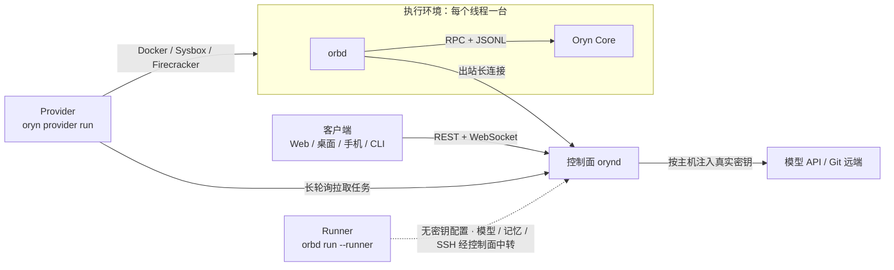

import Shot from '@/components/Shot.astro';

*本页回答：Oryn 是什么，由哪几部分组成？*

<Shot id="readme/hero" alt="Oryn 横幅：左侧是 Oryn 标志与「一个线程，一台专属机器。」标语，右侧是线程页，运行中的 bash 工具卡以伪代码视图显示测试命令，最右是环境的信息面板。" />

Oryn 是自托管的 Coding Agent 工作台：每个对话线程独占一台隔离的执行环境（orb），模型与 Git 凭据默认经控制面的出站代理注入，你在浏览器、桌面、手机与终端里接续同一份工作。

## 一条线程从哪里跑起来

你在客户端里开一个线程，向 Agent 交代任务。控制面为这个线程准备一台新环境，Agent 内核 Oryn Core 在环境里运行；环境由接入控制面的 Provider 在宿主机上用 Docker、Sysbox 或 Firecracker 拉起，也可以是你自己机器上的 Runner。环境里的 `orbd` 主动向控制面建立出站长连接，客户端经 REST 与 WebSocket 与控制面通信，所以无论你从哪个客户端打开，看到的都是同一个线程、同一台环境。

模型 API Key 与 Git 令牌不放进环境：默认 `proxy` 模式下，环境里的配置只有 `oryn-ph-…` 占位符，真实值由控制面按上游主机注入。完整的边界见[安全模型总览](/security/overview/)。

## 组件

| 组件 | 职责 |
|---|---|
| `orynd` | 控制面，单个二进制：REST 与 WebSocket、SQLite、Passkey 与设备配对、调度、协调沙箱、出站密钥注入代理，并内嵌 Web 前端 |
| `orbd` | 环境内的守护进程：出站长连接回控制面，监督 Oryn Core，托管服务、桌面与本地出站代理；`--runner` 模式把个人机器接入为 Runner |
| `oryn` | 命令行客户端，也是宿主机上的 Provider 执行器（`docker`、`firecracker`、脚本 `dispatch`） |
| Web 与壳 | React 前端，以及桌面与移动端的 Tauri 2 壳 |
| Oryn Core | Agent 内核，fork 自 `can1357/oh-my-pi`，在每台环境里运行 |

客户端覆盖浏览器（Web / PWA）、Windows / macOS / Linux 桌面 App、Android、iOS（TestFlight）与 `oryn` CLI。客户端只带一个配对页，配对后加载服务器自己的 Web UI，因此服务端升级后各端界面同步更新。

## 执行后端

同一个控制面可以同时接入以下后端，按项目或线程选用：

| 后端 | 隔离方式 | 适合 |
|---|---|---|
| Docker | 普通容器，剥离 `NET_RAW` / `NET_ADMIN` | 默认选择 |
| Sysbox | 非特权 UID 映射，容器里可跑 `dockerd` | 需要 Docker-in-Docker 的项目 |
| Firecracker | 独立内核的 microVM | 不可信代码、需要内核级隔离 |
| 本机 Runner | 你自己机器上的普通用户进程，跑 Oryn Core，配置不含密钥 | 本地目录、本地硬件 |

环境跟着线程走：新线程总是得到一台新环境，空闲时自动冻结，打开线程或访问受管服务时自动唤醒。各后端的差别见[选择执行后端](/guide/environments/backends/)。

## 自托管，一个所有者

控制面运行在你自己的服务器上。首次启动、还没有所有者时，控制面在日志里打印一次性的 setup 链接；你用它注册 Passkey，就成为这套 Oryn 的所有者。界面与文档里的「主人」指的就是你。

## 版本状态

Oryn 目前只发布预发布版本，版本标签形如 `v<版本>-rc.N`。服务端、桌面与移动 App 统一发版。本站页脚标出页面内容核对到的 Oryn 版本。

## 相关

- [核心概念](/start/concepts/)
- [快速开始：在本机跑起来](/start/quickstart/)
- [部署总览](/admin/overview/)
- [安全模型总览](/security/overview/)
